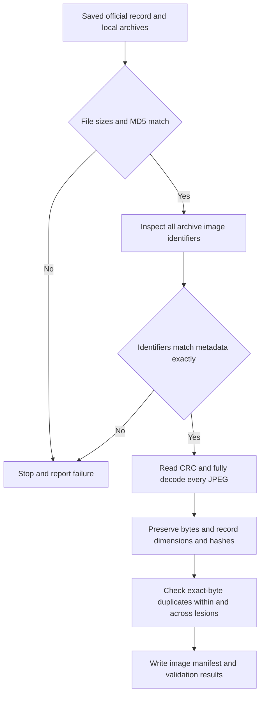

# Image validation workflow

The image audit verifies the saved official HAM10000 V4.0 archives, matches their contents to metadata, fully decodes every JPEG and preserves its original bytes. It is a local verification program and does not download files.

## Source files

| Archive | Official file ID | Bytes | Official MD5 |
| --- | ---: | ---: | --- |
| HAM10000_images_part_1.zip | 3172585 | 1366522108 | 4639bfa73ab251610530a97c898e6e46 |
| HAM10000_images_part_2.zip | 3172584 | 1403566547 | da43d6cc50f6613013be07e8986b384b |

These values come from the [saved dataset record](../data/raw/harvard_dataset_record_v4.json). The two archives total 2,770,088,655 bytes. Local storage must also accommodate extracted images.

## Checks

- Recalculate MD5 and compare byte counts; matching filenames are insufficient.
- Require unique archive image IDs and exact coverage of metadata IDs.
- Read every image with CRC validation and full JPEG decoding; record failures.
- Extract only verified image filenames. Existing files must match the archive bytes before reuse.
- Record dimensions, colour mode, byte count and SHA-256 in metadata row order.
- Identify exact-byte duplicates and whether they cross lesion IDs.

Run `python3 scripts/audit_images.py` from the A-stage directory after placing both archives in `data/raw/`. It requires Pillow. Outputs are the image directory, [manifest](../data/image_manifest.csv), [source record](../data/raw/images_provenance.json), [JSON audit](image_audit.json) and [results](03_image_validation_results.md).

This audit does not detect visual near-duplicates or prove patient independence. It performs no resize, augmentation, feature fitting or model training. Raw JPEGs and archives stay outside Git; small verification records are committed.
