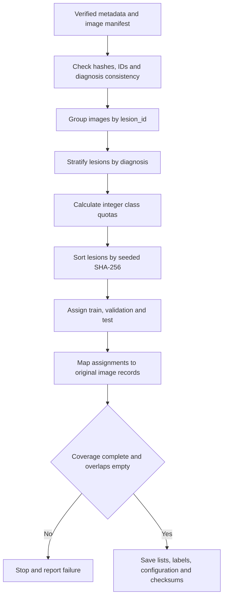

# Lesion-level stratified split

All images of a lesion receive one shared subset assignment. Lesions are stratified by diagnosis (`dx`), assigned deterministically, and then mapped back to image records. This prevents known views of the same lesion from crossing training, validation and test subsets.

Version `v1_seed42` uses target lesion proportions of 70% / 15% / 15% and seed 42. These are A-stage implementation choices, not course requirements or a confirmed team training configuration. All models and ablations must use the same approved lists and label mapping.



## Allocation algorithm

The targets apply to 7,470 lesions rather than 10,015 images. Integer global targets use half-up rounding for training and validation; test receives the remainder. The resulting targets are 5,229 training, 1,121 validation and 1,120 test lesions.

Training quotas use Hamilton's largest-remainder allocation, weighted by diagnosis lesion counts, to sum to 5,229. The remaining lesions form the held-out pool. A second Hamilton allocation assigns 1,121 validation lesions in proportion to diagnosis counts remaining in that pool; the rest become test lesions. Remainder ties use lexical diagnosis order. The implementation uses exact integer arithmetic.

Within each diagnosis, lesions are sorted by the hexadecimal value of:

```text
SHA256("HAM10000-lesion-split-v1|42|dx|lesion_id")
```

Here `dx` and `lesion_id` are replaced with their actual values. Equal hashes are resolved by lesion ID. The first quota goes to training, the next to validation and the rest to test. This is independent of input row order. The seed was not searched using model or test outcomes.

The class mapping is lexical: `akiec=0`, `bcc=1`, `bkl=2`, `df=3`, `mel=4`, `nv=5`, `vasc=6`. These numbers are output indices, not disease-severity ranks.

## Integrity and versioning

- Assign every image exactly once and preserve every original metadata field.
- Require empty pairwise image-ID and lesion-ID intersections.
- Require seven diagnoses in every subset and no exact-byte image hash crossing subsets.
- Keep same-lesion duplicates and metadata discrepancies documented rather than silently deleting them.
- Record both image and lesion counts. Do not split lesions to equalize image proportions.
- Save source metadata/manifest/script hashes and frozen-output checksums.
- Reject non-empty output directories. Reproduce into a fresh directory; changes to the split policy require a new shared version.

`data/splits/v1_seed42/` contains `combined.csv`, three subset CSVs, `lesions.csv`, `label_mapping.json`, `split_config.json` and `checksums.json`. See the [results](05_data_split_results.md) and [validation record](split_validation.json).

## Evaluation roles and limits

Training records support parameter fitting and training. Validation supports tuning, early stopping and model selection. Test supports final evaluation after those choices are fixed. Basic split-count checks do not authorize exploratory test-set tuning.

Patient IDs are absent, so lesion separation does not establish patient separation. Exact-byte checks do not exclude re-encoded or visually similar images. Benefit/Harm/Neutral analysis requires actual paired predictions from trained models and is outside this stage.
