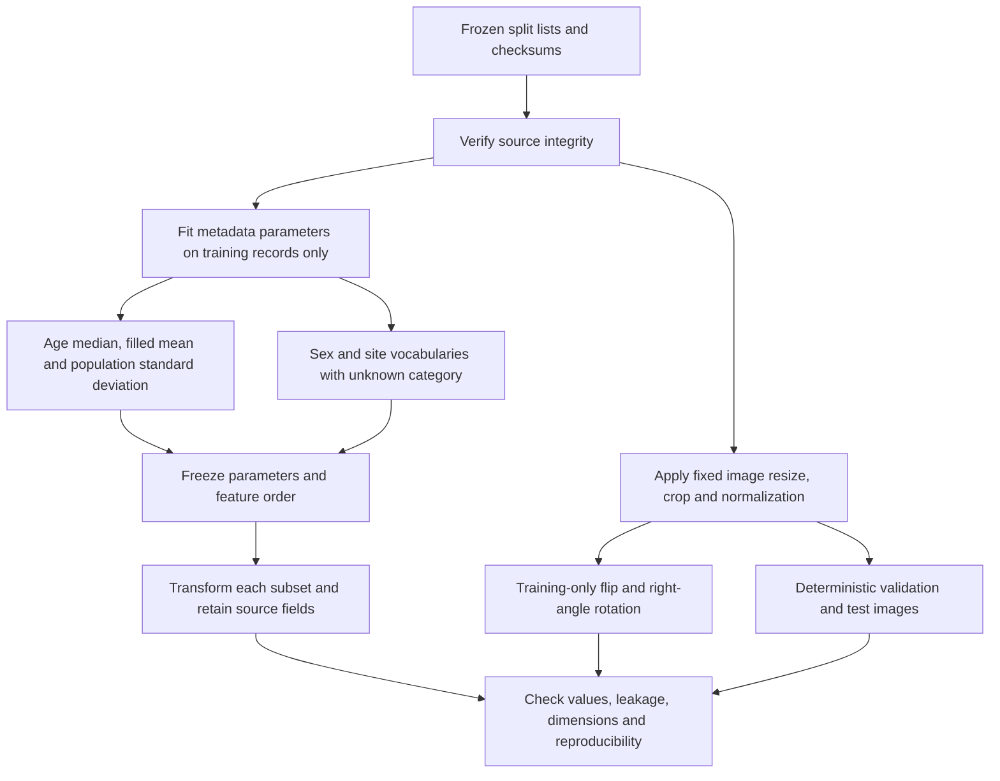

# Training-only preprocessing

The preprocessing stage preserves the frozen split and raw metadata. It fits age parameters and categorical vocabularies on training image records, then applies the saved rules to all subsets. Image transforms are lazy and do not replace original JPEGs.

## Metadata

Missing age is filled with the median of observed training ages. The mean and population standard deviation are calculated after filling all training image records. The model feature is `(age_imputed - train_mean) / train_std`. Multi-image lesions contribute multiple records; this is not lesion- or patient-weighted fitting.

Original `age` is retained. `age_missing` and `age_imputed` are audit columns, not extra model features in this version. Subgroup analysis should use original age and its missingness flag.

Sex and localization vocabularies come from training records and reserve `unknown`. Blank or unseen categories map to `unknown` without changing the vocabulary. One-hot columns have fixed order; original categorical fields remain available.

The full vector contains one age feature, three sex indicators and 15 site indicators: 19 features. The schema defines `all_metadata`, `age_only`, `localization_only` and `image_only` column lists. Labels, identifiers, source/confirmation fields, paths, hashes and split membership are excluded from predictors.

## Images

The proposed input recipe is explicitly `ResNet50_Weights.IMAGENET1K_V2`: bilinear resize to a shorter side of 232 pixels, centre crop to 224 x 224, scale RGB to [0,1], and normalize with mean [0.485, 0.456, 0.406] and standard deviation [0.229, 0.224, 0.225]. These are fixed external constants, not statistics fitted on this dataset. Output is float32 CHW with shape (3, 224, 224).

Training adds a horizontal flip with probability 0.5 and a rotation chosen from 0, 90, 180 and 270 degrees after cropping. A deterministic hash of run seed, epoch and image ID selects the transformation. Validation/test outputs do not depend on augmentation seed or epoch. Augmented copies are not distributed between subsets.

The weight version and transforms await coordination with the training member. Centre cropping can discard lesion boundaries; the preview supports implementation review, not an optimality claim. The Pillow/NumPy implementation has not been compared pixel-for-pixel with TorchVision. Reference: [ResNet-50 documentation](https://docs.pytorch.org/vision/stable/models/generated/torchvision.models.resnet50.html).

## Verification and outputs

Source hashes, subset membership and preservation of original fields are checked. Independent calculations verify age statistics and transformed values. Each one-hot group has exactly one active indicator. The fitting interface rejects non-training rows, and unseen categories do not alter parameters.

Image checks cover shape, type, finite values, raw-byte preservation, deterministic validation/test outputs and reproducible training augmentation. Reproduction compares the six processed artifacts byte-for-byte and confirms overwrite rejection.

`data/processed/v1_seed42/` contains three CSVs, `preprocessing_config.json`, `feature_schema.json` and `checksums.json`. See the [usage guide](07_preprocessing_guide.md) and [validation record](preprocessing_validation.json). No model training is performed here.
