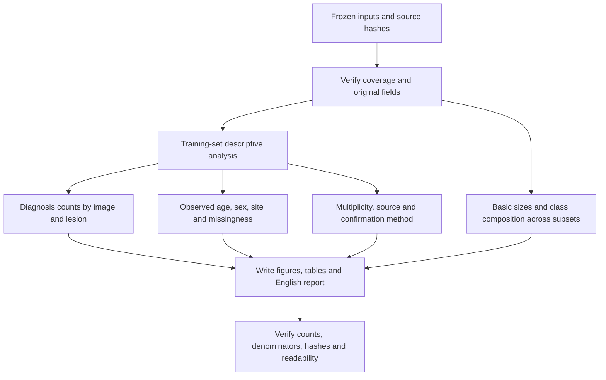

# Exploratory analysis method

EDA uses original metadata from the frozen split, with training records as the primary population. Validation/test inspection is restricted to basic counts and diagnosis composition. The analysis does not reassign samples, refit preprocessing or train models.

## Figure groups

| Figure | Population and unit | Purpose |
| --- | --- | --- |
| 01 Class distribution | Training images and distinct lesions | Class imbalance and minority-class evidence |
| 02 Age | Training images with observed original age | Age distribution and descriptive diagnosis differences |
| 03 Sex and site | Training image records | Coverage, small categories and unknown values |
| 04 Missingness | Training images, overall and within diagnosis | Field counts, rates and overlap |
| 05 Multiplicity and provenance | Lesions for multiplicity; images for source/confirmation | Repeated images and dataset composition |
| 06 Split composition | Basic image/lesion counts in all subsets | Stratification and image/lesion proportion differences |

Each group is saved as 300 dpi PNG and text-editable SVG. Thirteen CSV tables and a JSON summary retain numeric results. Titles, category labels and narrative are English.

## Statistical interpretation

Each row is an image, not a patient. Distinct-lesion counts deduplicate by `lesion_id`; they do not establish independent patients. Age summaries exclude blanks and use original `age`, not `age_imputed` or `age_z`. Zero remains an observed age. Five-year recorded values do not support finer measurement precision.

Unknown sex/site values are reported separately. Missingness fields can overlap, so their counts cannot be added as a distinct-image total. Within-diagnosis rates use that diagnosis's image count as denominator.

Associations describe these records. They do not establish why metadata is missing, whether fusion improves predictions, clinical fairness or causal effects. Source (`dataset`) and confirmation method (`dx_type`) remain audit fields.

No held-out metadata association or subgroup effect is used to choose the seed, preprocessing or model. Benefit/Harm/Neutral analysis must use actual paired test predictions after model selection.

## Verification

The validation program reconciles all 13 tables using CSV, Counter and statistics calculations independent of the plotting aggregates. It checks age definitions, denominators, missingness overlap and multiplicity totals. It validates six PNGs and six SVGs, confirms unchanged input hashes, reproduces statistics/report/PNG files exactly and checks SVG structure/canvas dimensions. SVG byte identity is not required.

Visual review covers titles, labels, long site/source names, numeric annotations, legends and footers. Results and provenance are linked from [EDA results](09_eda_results.md).
