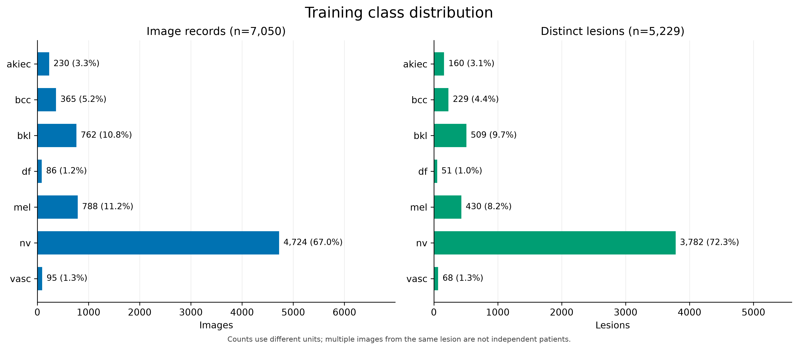
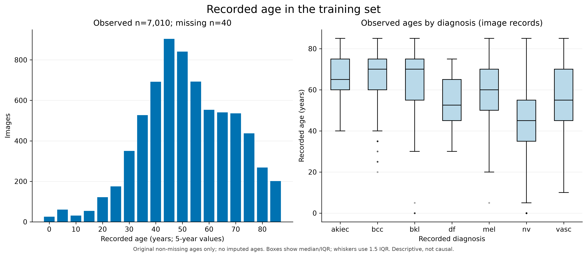
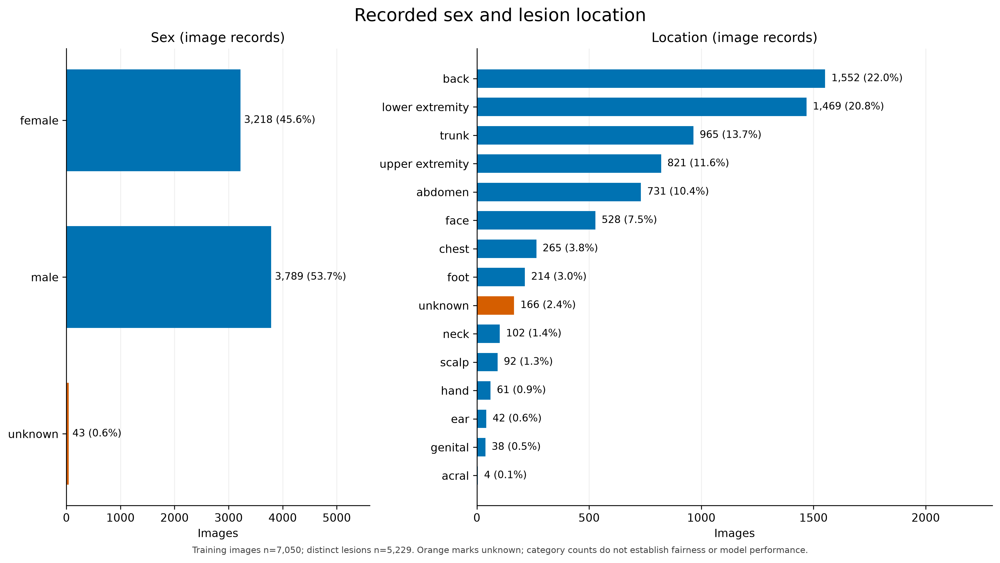
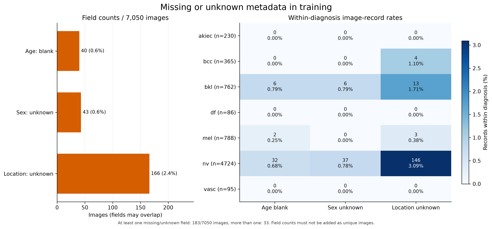
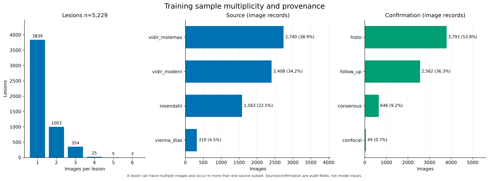
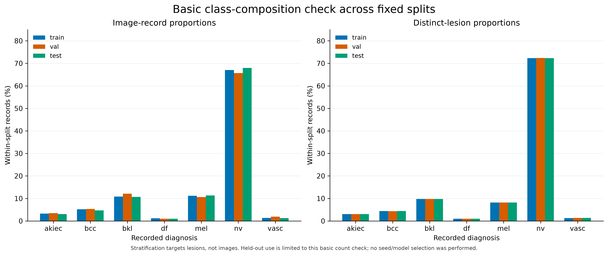

# HAM10000 exploratory data analysis

This descriptive analysis uses original fields from the frozen split. Training records are the primary EDA population. Validation and test inspection is restricted to basic sizes and class composition. No samples, split assignments or fitted parameters are changed, and no models are trained.

## Findings

The training subset contains 7,050 images from 5,229 distinct lesions. Class imbalance is substantial: nv accounts for 4,724 images (67.01%), whereas df contains 86 images (1.22%) from 51 lesions. The largest-to-smallest image-count ratio is 54.93. This motivates reporting macro-F1, class-specific metrics and a confusion matrix alongside accuracy.

Of the 5,229 training lesions, 1,390 have more than one image. Image-level metadata summaries therefore repeat some lesion information and do not represent independent patient observations. No patient identifier is available.

Age summaries use 7,010 observed values, excluding 40 missing values. The median is 50 years (IQR 40-65), with range 0-85 and mean 51.7646. Ages occur in five-year increments and age zero is retained. The observed-age mean differs from the preprocessing mean, which includes imputed records.

There are 40 missing ages, 43 unknown sex values and 166 unknown sites. The fields overlap: 183 distinct images have at least one missing/unknown field and 33 have more than one. The field counts must not be added as a count of affected images.

Recorded sex counts are male=3,789, female=3,218 and unknown=43. The most frequent site, back, has 1,552 images; the least frequent, acral, has 4. Small subgroups require cautious interpretation of later performance estimates.

The training data includes four source subsets and four confirmation methods. Histopathology (`histo`) is recorded for 3,793 images (53.80%). This image-record proportion is not a lesion-level pathology-confirmation rate. Source and confirmation method are audit fields, not predictors.

All subsets contain seven diagnoses. Stratification targets lesion proportions, so image proportions can differ from 70% / 15% / 15%. The composition figure is a basic integrity check; the seed was not selected from model or held-out outcomes.

## Figures

### Class distribution

Image and distinct-lesion counts use different denominators. Minority-class evidence remains limited.

[SVG version](figures/01_class_distribution.svg). Underlying counts are available in `tables/`.

### Observed age

Both panels exclude missing ages. Imputed ages are not treated as observations. Diagnosis-associated age patterns alone do not establish predictive benefit.

[SVG version](figures/02_age_distribution.svg). Underlying counts are available in `tables/`.

### Recorded sex and site

Orange denotes unknown values. These counts describe coverage; they do not measure fairness or model performance.

[SVG version](figures/03_sex_and_location.svg). Underlying counts are available in `tables/`.

### Missing and unknown metadata

The left panel uses all training images as its denominator. Each heatmap row uses images of that diagnosis. Counts can overlap across fields.

[SVG version](figures/04_missingness.svg). Underlying counts are available in `tables/`.

### Multiplicity and provenance

The multiplicity panel counts lesions; the other panels count image records. A lesion can occur in more than one source subset.

[SVG version](figures/05_multiplicity_and_provenance.svg). Underlying counts are available in `tables/`.

### Class composition across subsets

Within-subset proportions are shown separately for images and lesions. This is not a held-out subgroup-effect analysis or model comparison.

[SVG version](figures/06_split_class_composition.svg). Underlying counts are available in `tables/`.

## Interpretation limits

These are descriptive dataset results. They do not establish metadata-fusion gains, Benefit/Harm/Neutral counts, diagnostic performance, subgroup fairness or clinical benefit. Patient identifiers and relevant attributes such as skin tone are unavailable. Multiple images per lesion, minority classes, unknown metadata, source variation and confirmation methods should be addressed in the final discussion.

## Reproduction

Run `python3 scripts/eda.py --output-dir <new-empty-directory>` from the A-stage directory. Dependencies are recorded in `requirements_eda.txt`; `--deps-dir` supports an isolated dependency directory. Existing non-empty outputs are protected. Figures are 300 dpi PNG and text-editable SVG. Tables are CSV, complete statistics are in `eda_summary.json`, and hashes are in `eda_manifest.json`.

The English narrative is generated by the script. Regenerate it together with its manifest when changing the report template. Final report integration must reflect the group's actual experiments.
